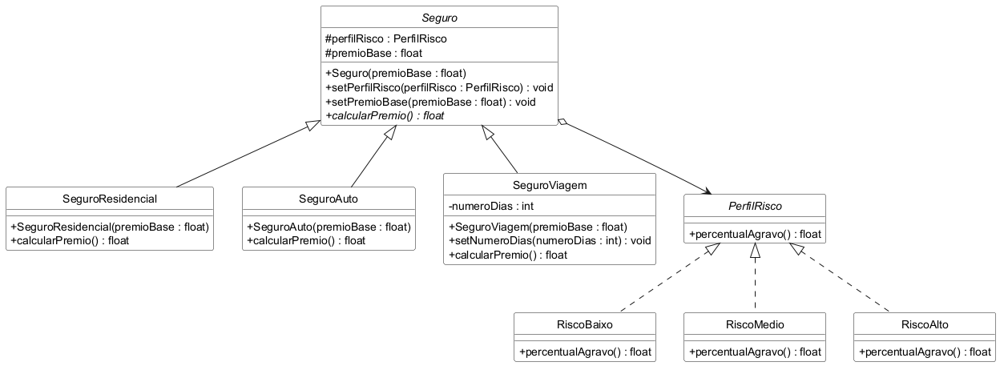

# Bridge

Trabalho da disciplina Aspectos Avançados em Engenharia de Software.

Exemplo do padrão Bridge em Java, com testes em JUnit 5. O tema é o mesmo da
seguradora usada nos trabalhos do Abstract Factory e do Singleton. O prêmio de
um seguro depende de duas coisas: o tipo de seguro (residencial, automóvel ou
viagem) e o perfil de risco do cliente (baixo, médio ou alto).

Se cada combinação virasse uma classe, seriam nove, tipo SeguroAutoRiscoAlto.
Com o Bridge, o seguro guarda uma referência para o perfil de risco em vez de
herdar dele. Assim os dois lados crescem separados: um seguro novo não mexe nos
perfis, e um perfil novo não mexe nos seguros.

## Diagrama de classes

